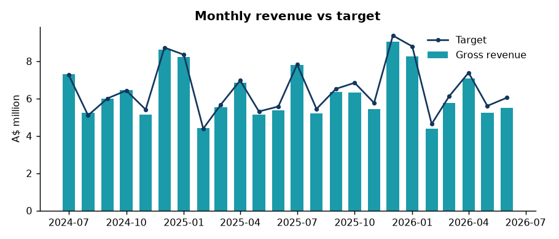
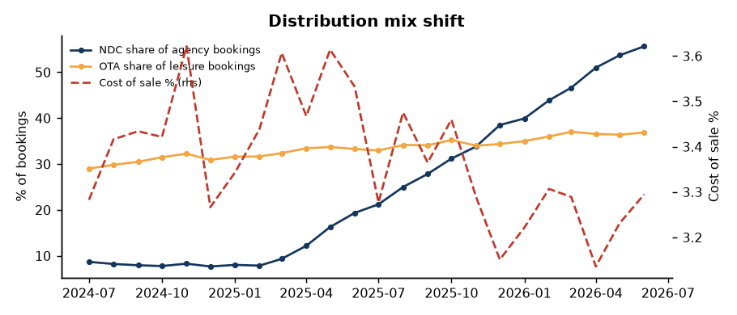
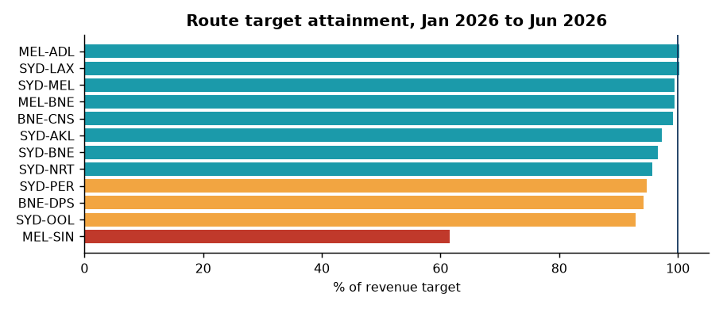
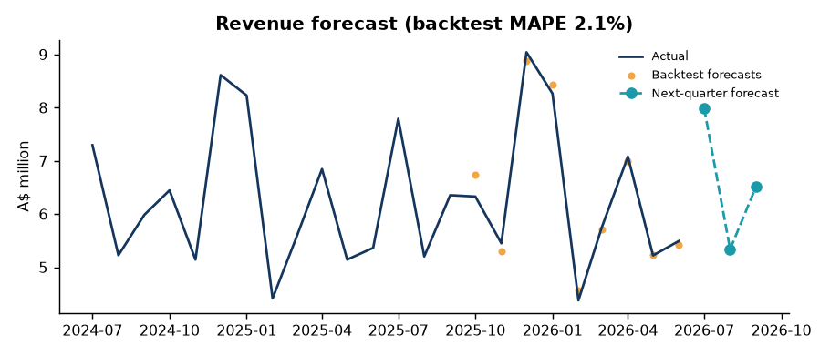
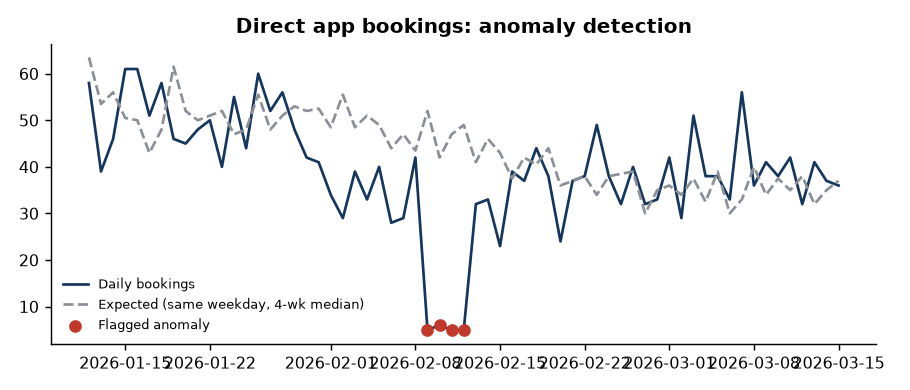

# airline-sales-insights

Sales and distribution analytics for **Southern Cross Air**, a fictional Australian carrier. The project covers the whole loop a commercial analytics team runs every month:

1. **Data**: a seeded generator produces two financial years (1 Jul 2024 to 30 Jun 2026) of daily bookings. There are 220,569 bookings across 7 domestic and 5 international routes, plus monthly route targets.
2. **Model**: a DuckDB star schema (`sql/schema.sql`) with KPI views (`sql/views.sql`).
3. **Analysis**: trend and change-point detection, variance to target, daily anomaly alerts and a backtested next-quarter forecast (`src/asi/analysis.py`).
4. **Automated reporting**: one command rebuilds the Excel commercial pack and an HTML/PDF one-pager with quantified recommendations.
5. **Power BI**: the star schema is exported as Parquet/CSV. [POWERBI.md](POWERBI.md) gives the model, the DAX measures and a page layout.

All data is synthetic. Every number below is read from `output/findings.json` after `make all` with the default seed.

## Quick start

```bash
pip install -e ".[dev]"
make all        # or: python -m asi.cli all --docs && python scripts/publish_powerbi.py
make test       # 18 tests
```

The full pipeline runs in about 3 seconds on a laptop CPU: generate 0.5 s, model 0.7 s, analysis 0.2 s, reporting 1.3 s.

| Output | Path |
|---|---|
| Excel commercial pack (7 sheets, native charts, conditional formatting) | `output/Commercial_Pack.xlsx` |
| One-pager | `output/OnePager.html`, `output/OnePager.pdf` |
| Machine-readable findings | `output/findings.json` |
| DuckDB database with all views | `output/sales.duckdb` |
| Power BI star schema | `output/powerbi/{csv,parquet}/`, Parquet committed in `data/powerbi/` |

## Results (measured, default seed)

| Finding | Measured value |
|---|---|
| FY26 gross revenue | $76.4m, +2.8% on FY25 ($74.3m) |
| FY26 net revenue after refunds and distribution cost | $68.9m, +3.3% on FY25 |
| NDC share of agency bookings | 8.1% in the first 6 months to 48.5% in the last 6. The trend is +2.3 pp a month (t = 16.0), and the hinge fit puts the start in **Mar 2025** |
| Cost of sale (distribution cost / gross revenue) | 3.41% → 3.25%. Cost per booking fell from $23.26 to $21.75 |
| OTA share of leisure bookings | 30.6% → 36.3% (+0.31 pp a month, t = 17.6) |
| Network target attainment, Jan to Jun 2026 | 93.8%, or 97.6% excluding MEL-SIN |
| Underperforming route | **MEL-SIN** breaks in **Oct 2025**. Attainment fell from 98% to 61%, passengers per month fell 29% and yield fell 8%. The route is $1.57m behind target over Jan to Jun 2026 |
| Routes below 95% of target (last 6 months) | MEL-SIN, SYD-OOL, BNE-DPS, SYD-PER |
| Daily anomaly alerts | 5 channel-days flagged. Four are a sustained direct-app drop (9 to 12 Feb 2026, z ≈ −9 to −11, about 169 bookings or $115k lost). One is a single-day web dip (11 Feb 2025) left for review |
| Next-quarter forecast (Jul to Sep 2026) | $19.8m, against $19.3m in the same quarter last year |
| Forecast accuracy, 7-origin rolling backtest, 3 months ahead | Seasonal naive × trailing YoY: **MAPE 2.1%**. Plain seasonal naive: 2.7% |

### Recommendations generated by the run

| # | Recommendation | Quantified impact (trailing 12 months) |
|---|---|---|
| 1 | Move 50% of remaining GDS agency bookings to NDC | Saves about **$250,672 a year** in distribution cost ($40.59 vs $26.79 per indirect booking) |
| 2 | Win back 10% of OTA leisure bookings to direct web/app | Adds about **$163,877 a year**. An OTA booking costs $54.03 vs $7.93 direct, and attaches ancillaries 21.1% of the time vs 36.8% |
| 3 | Review capacity and pricing on MEL-SIN | **$1,568,691** behind target over Jan to Jun 2026 |
| 4 | Use NDC rich content to sell ancillaries through agents | Adds about **$234,224 a year** (NDC attach rate 27.6% vs 11.6% on GDS) |
| 5 | Add release monitoring on direct booking channels | About **169 bookings ($115,403)** lost in the Feb 2026 app incident |

## Charts







## Project layout

```
src/asi/config.py      reference data (routes, channels and cost rates, fare families) and story dates
src/asi/generate.py    seeded synthetic bookings + targets
sql/schema.sql         star schema: dim_date, dim_route, dim_channel, dim_fare, dim_pos, dim_segment, fact_booking, fact_target
sql/views.sql          KPI views: v_kpi_monthly, v_kpi_yoy_mom, v_channel_mix_monthly, v_route_monthly,
                       v_target_attainment, v_leadtime_cohort, v_daily_channel
src/asi/model.py       loads data into DuckDB, runs the SQL, exports CSV/Parquet
src/asi/analysis.py    trends, change points, variance, anomalies, forecast, recommendations
src/asi/charts.py      PNG charts
src/asi/excel_pack.py  openpyxl commercial pack
src/asi/onepager.py    HTML + PDF one-pager
src/asi/cli.py         `python -m asi.cli all|report|export`
tests/                 pytest: determinism, reconciliation of views to raw data, story detection, reports
```

See [GUIDE.md](GUIDE.md) for a plain-English walkthrough and [POWERBI.md](POWERBI.md) for the Power BI build.

## Limitations

The data is synthetic, and the three business stories were planted on purpose. The tests check that the analysis finds them without being told where they are. The cost rates are illustrative. Seat capacity is a fixed daily schedule, so the RASK figure is a proxy. The forecast has only 7 backtest origins, because two years of data leaves 12 months for the seasonal baseline.
